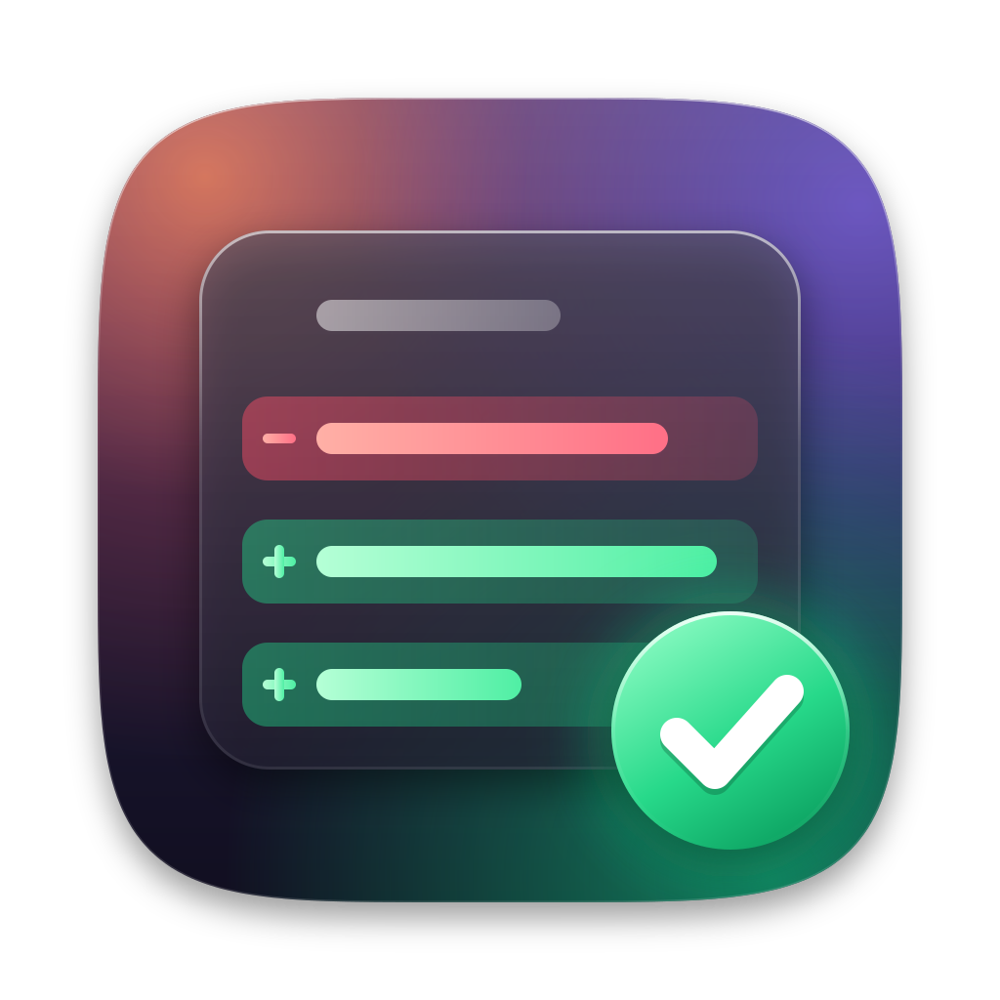

<p align="center">
  
</p>

# vs-kot

vs-kot is an editor for teams whose code is written by a coding agent. The agent works in its own app. vs-kot is where a person reads each change the agent made and signs it off, one change at a time.

It is a fork of [Visual Studio Code - Open Source](https://github.com/microsoft/vscode) ("Code - OSS"). It is an independent project, not affiliated with or endorsed by Microsoft or Anthropic.

## Why

We write most of our code with a coding agent, [Claude Code](https://claude.com/claude-code). That changed what we need from an editor. Typing is no longer the slow part of the work; reading is. An agent hands us more changes in a day than anyone used to type, and each of them still has to be understood by a person before it becomes part of the product.

Editors built around AI put the agent inside the editor. We want the opposite split: the agent works in its own app, and the editor is the quiet place where its work is read, questioned and approved. The one thing we missed after moving to a standalone agent was the inline review that AI editors offer for their own agents. vs-kot brings that review to changes from any agent, because it looks at git and not at the agent.

## What we want it to be

- **A review tool first.** Every change an agent makes shows up inline, in the file, and stays marked until a person has approved it. Approving takes one key.
- **Quiet.** No chat panel, no assistant, and an activity bar with three icons. The only AI in the editor is tab completion, because it helps while reading code and fixing things by hand.
- **Private by default.** Tab completion comes from a model that runs on your own Mac. No code leaves the machine unless you point the editor at a model server of your own.
- **The same for everyone on a team.** Formatting rules and the extensions a team relies on ship with the app, so a new teammate has the team's setup after one download.
- **Close to upstream.** vs-kot is VS Code with a small number of clearly marked changes. We follow upstream releases and keep our changes small enough to carry forward.

vs-kot is not a general-purpose VS Code distribution. If you want VS Code without Microsoft's branding and telemetry, [VSCodium](https://vscodium.com) is the project for that.

## What is different from VS Code

### Change review

A change that is not staged in git counts as not reviewed. vs-kot shows every such change inline in the normal editor, removed lines in red and added lines in green, with two buttons on each change:

- **Approve** (`⌘Y`) stages that one change in git. Staged means reviewed.
- **Request Change** (`⌘N`) copies the file, the lines, the passage and your note to the clipboard, ready to paste to the agent.

A floating bar moves between changes (`F7`, `⇧F7`) and between files (`⌥F7`, `⇧⌥F7`) and approves a whole file (`⇧⌘Y`). When a file has nothing left to review, the editor jumps to the next changed file. When nothing is left at all, everything is staged and you commit as usual.

The settings `changeReview.enabled` and `changeReview.autoReveal` switch the review, and the automatic jump to new changes, on and off.

### No assistant in the editor

The chat and Copilot features that upstream ships are switched off and locked. Their settings and commands are hidden, and the Copilot extension is not built into the app.

### Tab completion from a local model

While you type, the editor suggests the rest of the line or a small block, and `Tab` accepts it.

- On first use the editor offers to download what it needs: the [Ollama](https://ollama.com) model server and the Qwen2.5-Coder 7B base model (about 4.7 GB), or the 1.5B model on a Mac with less than 16 GB of memory. Everything is kept in `~/.vs-kot/tab-completion`, and the server listens on this computer only.
- Suggestions use the real names from your project: the model also sees the definitions the current file imports and similar code from other open files.
- Files that usually hold secrets, such as `.env` files and keys, are never shown to a model.
- The Tab Completion view in the activity bar shows the state of the model server and lets you pick the model. Its icon is green when everything works and red when something needs attention.
- To use a model server of your own, set `tabCompletion.endpoint`. Ollama and OpenAI-style completion servers are supported.

### Team defaults

- Format on save, 4-space indentation and the matching Prettier settings are locked. The Settings editor shows them as managed.
- Prettier, Auto Close Tag, Auto Rename Tag and the ES7+ React snippets are built in.
- Extensions are installed from [Open VSX](https://open-vsx.org).

These are our team's choices. They live in one file, [product.json](product.json), under `vsKotManagedSettings`, `vsKotDefaultSettings` and `builtInExtensions`, so another team can replace them with its own.

### Smaller changes

- The activity bar shows Search, Explorer and Tab Completion. The other views are still there: right-click the bar to bring one back.
- The default theme is Dark Modern.

## Status

vs-kot is young and used by one team. It is built and tested on macOS with Apple Silicon only. The app is not signed with an Apple developer certificate. It is currently based on VS Code 1.146.0.

## Install

1. Download `vs-kot-darwin-arm64.zip` from the [latest release](../../releases/latest).
2. Unzip it and move `vs-kot.app` to the Applications folder.
3. macOS blocks the first start of an app without a developer signature. Remove the download flag once:

   ```bash
   xattr -dr com.apple.quarantine /Applications/vs-kot.app
   ```

   The other way is System Settings > Privacy & Security > Open Anyway.
4. Open the app. To get tab completion, open the Tab Completion view and choose Set Up.

After an update macOS treats the app as new and asks again for access to folders such as Documents.

## Build from source

The requirements are those of upstream, see [How to Contribute](https://github.com/microsoft/vscode/wiki/How-to-Contribute). The repo pins its own pnpm version; `.vs-kot/bin` holds a launcher for it.

```bash
export PATH="$PWD/.vs-kot/bin:$PATH"
pnpm install
pnpm run compile-client
.vs-kot/run.sh path/to/a/project
```

- `.vs-kot/package.sh` builds the macOS app and the zip for a release. The result lands next to the repo folder, in `VSCode-darwin-arm64/`.
- `.vs-kot/release-check/` holds a check that drives a real window through every feature listed above. Run it before a release, on the source build and on the packaged app.

## How the fork is organised

- The branch `upstream-snapshots` holds one commit per upstream release. `main` is our commits on top of it. To take a new upstream release, its tree becomes the next commit on `upstream-snapshots` and `main` is rebased onto it.
- Our code lives in folders of its own. Edits to upstream files are kept small and carry a `vs-kot:` comment, so `git grep "vs-kot:"` lists every one of them.

| What | Where |
| --- | --- |
| Change review | `src/vs/workbench/contrib/changeReview/` |
| Tab completion | `extensions/vs-kot-tab-completion/` |
| Tab Completion view | `src/vs/workbench/contrib/vsKotTabCompletion/` |
| Team settings | `product.json`, `src/vs/workbench/contrib/vsKotTeam/` |
| AI switched off | `src/vs/platform/chat/common/vsKotAIOff.ts` |
| Activity bar | `src/vs/workbench/browser/parts/vsKotActivityBar.ts` |
| Scripts, icon, release check | `.vs-kot/` |

## License

Licensed under the [MIT](LICENSE.txt) license.

vs-kot is built from Code - OSS. The copyright of the original code stays with Microsoft Corporation and the authors listed in [ThirdPartyNotices.txt](ThirdPartyNotices.txt). The model server and the models for tab completion are downloaded on setup and are not part of this repository: Ollama is under the MIT license, the Qwen2.5-Coder 7B and 1.5B models under Apache 2.0.

"Visual Studio Code" and "VS Code" are trademarks of Microsoft Corporation. "Claude" is a trademark of Anthropic. This project is independent of both companies.
